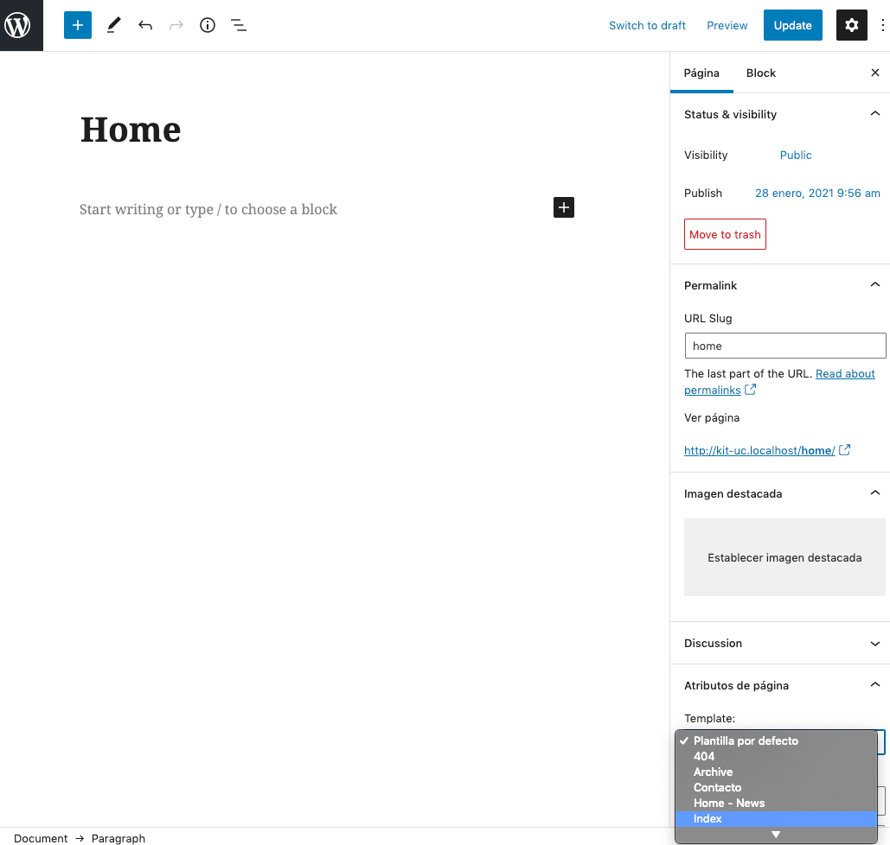
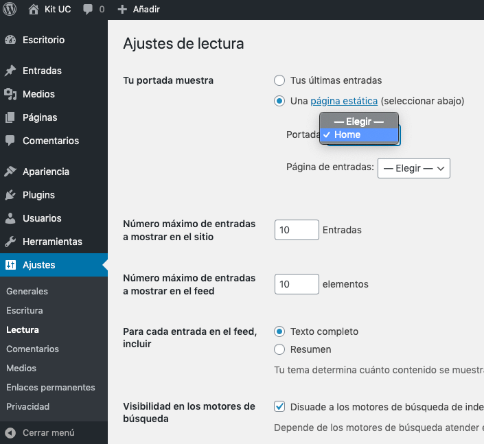
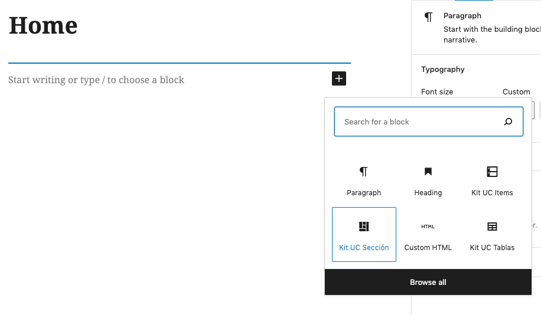
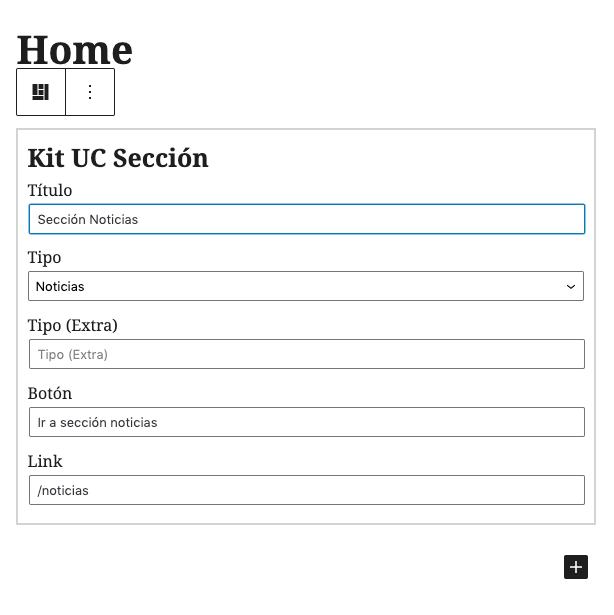
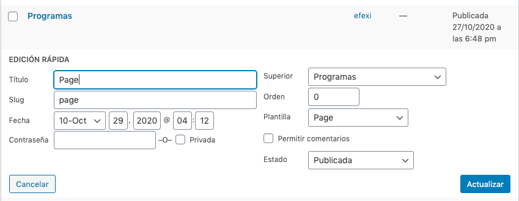
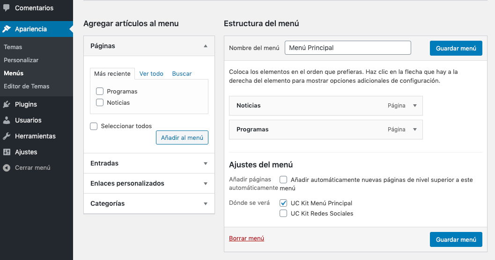
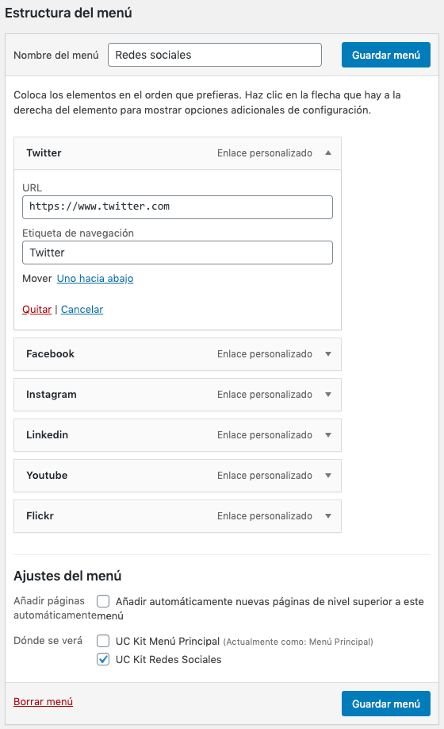
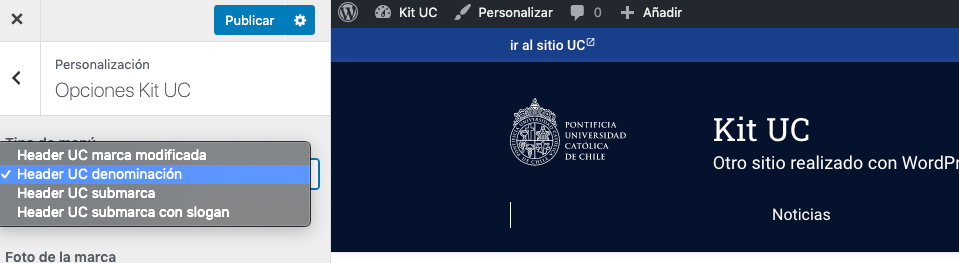

# Kit UC Wordpress

Template compatible solo con SO GNU Linux, evitar usarlo en SO Windows

El presente template es un recurso que está actualmente en proceso de desarrollo y validación, pensado para ser usado
para construir sitios web para la Pontificia Universidad Católica de Chile, utilizando el Kit Digital (https://kitdigital.uc.cl/),
bajo licencia Creative Commons Reconocimiento-NoComercial-SinObraDerivada 4.0 Internacional
(https://creativecommons.org/licenses/by-nc-nd/4.0/).

El uso de este template debe ser solicitado e informado a la Dirección Digital de la UC (direcciondigital@uc.cl).

### Pasos de instalación

Luego de instalar WordPress, sigue estos pasos para configurar el tema:

1. En tu panel de WordPress, en el menú lateral izquierdo, ve a "Apariencia > Temas".
2. Haz clic en "Agregar nuevo".
3. Luego, haz clic en "Cargar tema".
4. Busca en tu computadora el archivo ZIP del tema principal que descargaste de GitHub y haz clic en "Instalar". **No lo actives**.
5. Repite los pasos 2 a 4 para el archivo ZIP del tema hijo.
6. Activar el tema hijo.

Se deben crear las páginas partiendo por home, seleccionando como template **"Index"**

- En el caso de la sección noticias, solo se debe crear la página y seleccionar el template **"Home - News"**
- En el caso de la sección programas el template **"Programas"**
- En el caso de la sección quienes somos el template **"About"**

Una vez creada asignar como página estática

Para agregar las secciones del Home, es cosa de ir a la página definida como home
y añadir un bloque **"Kit UC Sección"**

Donde por ejemplo si se coloca el tipo **"Noticias"** aparecerá esta sección
en el Home vinculado a todas las entradas.

Si se coloca el tipo **"Programas"** aparecerá esta sección en el Home
vinculando a la página que tenga el template **"Programas"** y mostrará
todas las páginas que tienen a esta página de superior.

Para crear los menús se debe ir a
> Apariencia > Menús

Y crear los menús necesarios, principalmente 2:

- UC Kit Menú Principal
- UC Kit Redes Sociales

En el caso del menú de redes sociales, los vínculos se deben agregar de esta forma:

Para modificar el tipo de header ir a
> Apariencia > Personalizar > Opciones Kit UC

NOTA: línea de texto agregada para testear que las actualizaciones al repositorio están ok
NOTA2: segunda línea agregada para comprobar que se necesita aumentar el valor de "Current Version" al final de este archivo y el de "Version" en style.css que se encuentra en la raíz de esta carpeta

### Recomendaciones:
En caso de que el listado de Noticias se encuentre roto, se recomienda revisar los plugins instalados ya que hay una posibilidad de que alguno de ellos esté generando conflicto con el listado de noticias.

~Current Version: 1.1.20~
